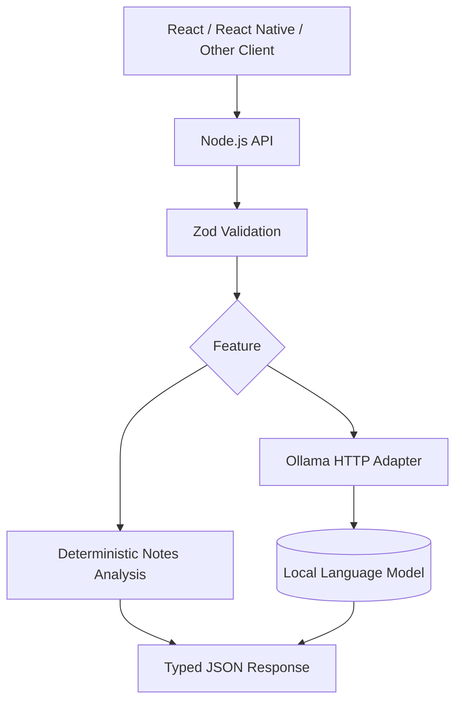

<div align="center">

# ✨ AI Features Lab

### Practical AI capabilities for real-world software products.

**Applied AI · Node.js · TypeScript · Local LLMs · Education Technology**

[](https://www.typescriptlang.org/) [](https://ollama.com/) [](#design-principles)

*A small, runnable showcase of integrating AI into useful workflows — without hiding the engineering behind the model.*

</div>

---

## 👋 Why I built this

My background combines software engineering, React Native, Node.js, technical leadership, and an interest in applying AI to education and everyday operations. I am particularly interested in features that reduce repetitive work and make human expertise more accessible.

This repository explores a concrete scenario: **turning meeting or lesson notes into actionable follow-up information**. It combines deterministic text processing with an optional locally hosted language model.

> **Product principle:** Start with the user's problem. Add AI only where it provides value beyond a simpler solution.

## 🧪 Implemented features

| Feature | How it works | Requires a model? |
| :--- | :--- | :---: |
| **Action extraction** | Finds explicit `TODO`, `ACTION`, `NEXT`, and `HOMEWORK` lines | No |
| **Notes overview** | Returns line count, preview, and extracted actions | No |
| **AI-assisted summary** | Sends notes to a configured local Ollama model | Yes |
| **Input validation** | Validates text length and request shape with Zod | No |
| **Consistent API errors** | Returns structured errors when input or local inference fails | No |

## 🏗️ Architecture



## 🚀 Run locally

Requires **Node.js 20+** and npm. The deterministic endpoint works without Ollama.

```bash
npm install
npm run dev
```

**Analyze notes**

```bash
curl -X POST http://localhost:3000/api/v1/notes/analyze \
  -H 'Content-Type: application/json' \
  -d '{"notes":"Lesson: React hooks\nHOMEWORK: Build a custom hook\nTODO: Review useEffect"}'
```

**Optional: local AI summary**

Install Ollama, pull the configured model, and ensure its API is running. The default model is `qwen3.5:4b`; you can change it using `OLLAMA_MODEL`.

```bash
ollama pull qwen3.5:4b
curl -X POST http://localhost:3000/api/v1/notes/ai-summary \
  -H 'Content-Type: application/json' \
  -d '{"notes":"We discussed React Native architecture and agreed to review navigation patterns."}'
```

## 🧠 Design principles

- **Local-first inference:** keep the integration configurable and avoid hard-coding third-party API keys.
- **Explicit boundaries:** separate validation, deterministic analysis, and LLM calls.
- **Graceful failure:** set a timeout and return a structured response when Ollama is unavailable.
- **Honest AI claims:** extracted action items are rule-based; the optional summary is model-generated and must be reviewed.
- **Privacy awareness:** notes are forwarded to the configured Ollama endpoint; avoid submitting sensitive data to endpoints you do not control.

## 🧪 Quality checks

```bash
npm run typecheck
npm test
npm run build
```

## 🗺️ Future experiments (not implemented)

- [ ] Teacher feedback from student practice notes and recordings
- [ ] Structured output schemas and evaluation datasets
- [ ] Human review before sending follow-up messages
- [ ] RAG over approved course materials
- [ ] Streaming responses and cancellation
- [ ] Authentication, rate limits, audit logs, and integration tests

## 👨‍💻 About the author

Created by [Cristian / Crisesm](https://github.com/Crisesm) as a portfolio example of applied AI engineering. Related work: [Mobile Platform](https://github.com/Crisesm/mobile-platform) · [Node BFF Reference](https://github.com/Crisesm/node-bff-reference) · [Tech Lead Handbook](https://github.com/Crisesm/tech-lead-handbook).

---

<div align="center"><sub>Useful AI starts with useful product thinking.</sub></div>
